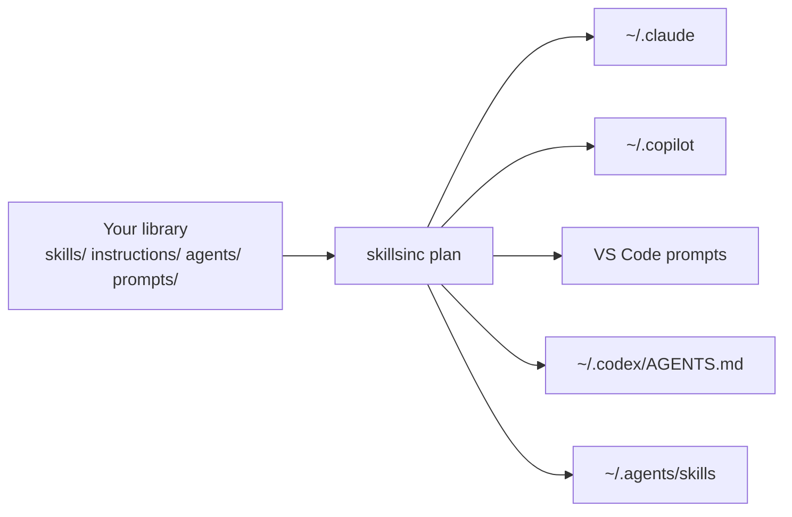

# SkillSinc

[](https://github.com/mikejhill/skillsinc/actions/workflows/ci.yml)
[](https://github.com/mikejhill/skillsinc/actions/workflows/release.yml)
[](LICENSE)

Write your agent skills, instructions, agents, prompts, MCP servers, reference files, and hooks once. SkillSinc copies them into Claude Code, GitHub Copilot, VS Code, Codex, and the shared `~/.agents` folder, converting formats where it must and saying so when a conversion loses something.

It replaces hand-copying, symlinks, and per-tool sync scripts with one command that shows you every change before it makes it.

## How it works



- **Your library is the source of truth.** A sync makes each destination match it: new items are added, changed items updated, removed items deleted.
- **SkillSinc only touches what it wrote.** It records every file it owns. An existing file it did not write blocks that destination until you review it and pass `--adopt`.
- **Nothing is written without a plan.** `skillsinc plan` lists every change; `skillsinc sync` applies the same plan.
- **Lossy conversions are opt-in.** If a harness cannot represent a field (for example, Claude ignores Copilot `tools` lists), the item is skipped until the route sets `allow_lossy = true`.
- **A broken source never deletes anything.** If a library cannot be read completely, its destinations are left untouched.

## Install

Requires Python 3.12+ and [uv](https://docs.astral.sh/uv/).

```bash
uv tool install git+https://github.com/mikejhill/skillsinc.git
```

## Quick start

1. Point SkillSinc at your library. It enables a destination for every harness folder found on this machine:

    ```bash
    skillsinc init --source ~/my-agent-library
    ```

2. Preview the changes:

    ```bash
    skillsinc plan
    ```

3. Apply them:

    ```bash
    skillsinc sync
    ```

Run `skillsinc sync` again whenever the library changes, or schedule it with Task Scheduler, launchd, or a systemd timer using the [scheduling examples](docs/guides/scheduling.md). An overlapping run exits without writing.

## Library layout

The layout matches GitHub Copilot's file conventions, so an existing Copilot library works unchanged:

```text
my-agent-library/
├── skills/<name>/SKILL.md            # plus any supporting files
├── instructions/<name>.instructions.md
├── agents/<name>.agent.md
├── prompts/<name>.prompt.md
├── mcp/<name>.json                   # one MCP server definition per file
├── resources/<name>.md               # reference files, copied as written
├── hooks/<name>.json                 # one Copilot CLI hook file per file
└── plugins/<plugin>/                 # Claude Code plugin layout, expanded into the kinds above
```

`INTENT.md`, `*.intent.md`, and hidden files are never distributed. A plugin's `skills/`, `agents/`, `commands/`, and `.mcp.json` are synced as skills, agents, prompts, and MCP servers; everything else in it (hooks, scripts, LSP servers) is reported as a loss. See [decision 0005](docs/decisions/0005-plugins-expand-into-kinds.md).

## What each harness receives

| Profile   | Skills    | Instructions                 | Agents               | Prompts              | MCP servers                    | Resources                             | Hooks                   |
| --------- | --------- | ---------------------------- | -------------------- | -------------------- | ------------------------------ | ------------------------------------- | ----------------------- |
| `claude`  | `skills/` | `rules/<name>.md` (`paths`)  | `agents/<name>.md`   | `commands/<name>.md` | `~/.claude.json` `mcpServers`  | `resources/` + `CLAUDE.md` `@` import | `settings.json` `hooks` |
| `copilot` | `skills/` | `instructions/`              | `agents/`            | —                    | `mcp-config.json` `mcpServers` | `resources/`                          | `hooks/`                |
| `vscode`  | —         | `<name>.instructions.md`     | `<name>.agent.md`    | `<name>.prompt.md`   | `User/mcp.json` `servers`      | —                                     | —                       |
| `codex`   | —         | managed block in `AGENTS.md` | `agents/<name>.toml` | —                    | —                              | —                                     | —                       |
| `agents`  | `skills/` | —                            | —                    | —                    | —                              | —                                     | —                       |
| `generic` | verbatim  | verbatim                     | verbatim             | verbatim             | verbatim                       | verbatim                              | verbatim                |

Run `skillsinc profiles` for the same table. See [harness profiles](docs/guides/harness-profiles.md) for exact conversions.

## Commands

| Command              | Purpose                                            |
| -------------------- | -------------------------------------------------- |
| `skillsinc init`     | Write a starter configuration                      |
| `skillsinc plan`     | Show every change a sync would make; write nothing |
| `skillsinc sync`     | Apply the plan                                     |
| `skillsinc profiles` | List harness profiles and what each kind becomes   |

`plan` and `sync` accept `--destination NAME` (repeatable), `--adopt`, `--json`, `--verbose`, and `--config PATH`. Exit codes: `0` success, `1` a destination was blocked or failed, `2` configuration or usage error, `130` interrupted.

## Documentation

- [Configuration reference](docs/guides/configuration.md)
- [Command-line reference](docs/guides/command-line.md)
- [Scheduling](docs/guides/scheduling.md)
- [Development guide](docs/guides/development.md)
- [Roadmap](docs/planning/roadmap.md)
- [Harness profiles](docs/guides/harness-profiles.md)
- [Philosophy and goals](docs/architecture/philosophy.md)
- [Architecture](docs/architecture/overview.md)
- [Decision: rebuild scope](docs/decisions/0001-rebuild-scope.md)
- [Decision: MCP server entries](docs/decisions/0002-mcp-server-entries.md)
- [Decision: resources and Claude imports](docs/decisions/0003-resources-and-claude-imports.md)
- [Decision: TOML entries with tomlkit](docs/decisions/0004-toml-entries-with-tomlkit.md)
- [Decision: plugins expand into kinds](docs/decisions/0005-plugins-expand-into-kinds.md)
- [Decision: entry files beside a destination root](docs/decisions/0007-files-beside-the-root.md)
- [Decision: edit VS Code's JSONC mcp.json in place](docs/decisions/0008-jsonc-edits-in-place.md)
- [Contributing](CONTRIBUTING.md) · [Security](SECURITY.md) · [Changelog](CHANGELOG.md)

## License

[MIT](LICENSE)
