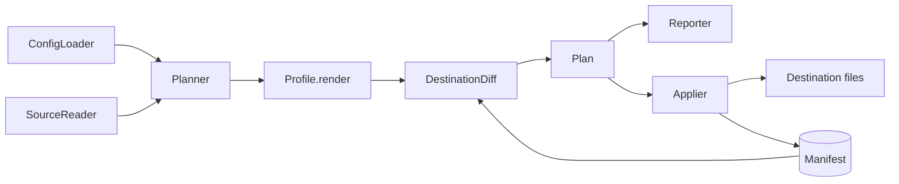

# Architecture

This document describes how a sync flows through SkillSinc's modules and how ownership is tracked. It is for contributors changing the planner, profiles, or apply logic.

## Flow

A run reads each routed source once, renders every selected item through the destination's profile, compares the result with the destination's files and ownership manifest, and only then writes.

## Modules

| Module                        | Responsibility                                                          |
| ----------------------------- | ----------------------------------------------------------------------- |
| `config`                      | Parse and validate `config.json` (JSONC) into frozen dataclasses        |
| `sources`                     | Read a library completely, expanding plugins, or raise `SourceError`    |
| `frontmatter`                 | Split Markdown into YAML frontmatter and body; render it back           |
| `profiles/*`                  | Per-harness layout and conversion; return files, blocks, and losses     |
| `planner`                     | Select items per route, render, apply loss policy, detect clashes       |
| `diff`                        | Compare desired files and blocks with disk and the manifest             |
| `blocks`                      | Find, replace, and remove the managed block in a Markdown file          |
| `entries`                     | Strict JSON, JSONC, and TOML editing of keyed entries in a shared file  |
| `jsonc`                       | Scan JSONC (config and `mcp.json`) and splice in-place edits            |
| `manifest`                    | Load and atomically save per-destination ownership records              |
| `applier`                     | Verify preconditions, write atomically, update the manifest             |
| `lock`                        | Serialize overlapping `sync` runs                                       |
| `report`                      | Text and versioned JSON output                                          |
| `schedule`                    | Register `sync` with Task Scheduler, launchd, systemd, or cron          |
| `cli`, `commands`, `__main__` | Argument parsing, command handlers, exit codes                          |

## Ownership

Each destination has a manifest at `$XDG_STATE_HOME/skillsinc/manifests/<destination>.json` (default `~/.local/state/skillsinc/`, on every platform). It maps destination-relative paths to the SHA-256 of the content SkillSinc last wrote, plus any managed blocks and whether SkillSinc created their file.

| Disk state                      | In manifest? | Desired? | Planned action                         |
| ------------------------------- | ------------ | -------- | -------------------------------------- |
| Missing                         | any          | yes      | `create`                               |
| Differs from desired            | yes          | yes      | `update` (notes local edits)           |
| Executable flag differs (POSIX) | yes          | yes      | `update`                               |
| Present                         | no           | yes      | blocked; `--adopt` → `adopt`/`track`   |
| Matches recorded digest         | yes          | no       | `delete`, then prune empty directories |
| Edited since SkillSinc wrote it | yes          | no       | `forget` (left in place, released)     |
| Missing                         | yes          | no       | `forget`                               |

## Managed blocks

Harnesses that read a single instructions file (Codex's `AGENTS.md`, Claude Code's `CLAUDE.md` for resource imports) receive one block delimited by `<!-- skillsinc:begin -->` and `<!-- skillsinc:end -->`. Content outside the markers is never changed. Damaged markers block the destination rather than guessing.

Blocks follow the same ownership rules as files. A block taken over with `--adopt` is reported as `adopt`. A block removed by hand is restored with a note. When no sections remain, an unedited block is removed (and its file deleted if SkillSinc created it and nothing else is left); an edited block is left in place and released. A path wanted in more than one form (whole file, managed block, config entries) blocks the destination.

## Managed entries

Harnesses that read MCP servers from a shared JSON or TOML file (Copilot CLI's `mcp-config.json`, Codex's `config.toml`) receive one entry per server under a container key such as `mcpServers` or `mcp_servers`. The manifest records each owned `container/key` with the digest of its value (key order and whitespace ignored) and whether SkillSinc created the file. Each entry follows the ownership table above and is reported as its own change, but all entry changes to one file are planned against one parse of it: they expect the file's current bytes and carry the bytes after every one of them, so the applier writes the file once and refuses all of them if it changed. Planning many entries in one file stays linear ([decision 0013](../decisions/0013-linear-first-sync.md)). Other keys are never changed, an unowned key with the same name blocks until `--adopt`, and a file that is not plain JSON, or not valid TOML, blocks the destination. TOML is edited with `tomlkit` and VS Code's JSONC `mcp.json` by splicing member text (`skillsinc.jsonc`), both keeping comments and layout, and the edited file is parsed back and compared with the intended data before it is planned. A file SkillSinc created is deleted when its last entry goes.

An entry may be marked mergeable (Claude Code hooks, keyed by event under `hooks` in `settings.json`). Several items may then contribute to one key: the planner concatenates their lists in item order, skipping elements already present, and the merged list is owned as one entry.

A profile may also write entries into files it declares beside its root (`Profile.outside`, such as Claude Code's `../.claude.json`), placed by `Profile.locate` and resolved by name rather than through links ([decision 0007](../decisions/0007-files-beside-the-root.md)). Shared files keep their permissions when rewritten.

## Safety checks

- Every change records the digest of the file it expects; the applier re-reads and refuses if the file changed after planning.
- Writes use a unique, exclusively created sibling temporary file, then `Path.replace` swaps it in. Existing files that happen to use a temporary-file name are not reused. A failed write cleans up its own staging file.
- Every applied step (one write, with all the entries it carries) is appended as one line to a journal beside the manifest (`<destination>.journal`), and the manifest is saved once when the destination finishes. Loading replays recorded journal steps after an interruption. Replacement is atomic per file; a destination is not one transaction, and there is no automatic rollback or backup of prior content.
- Planning refuses paths that pass through a symlink or junction beneath a destination root. A declared file beside the root must not be a link either; any other `..` path is refused.
- An error scanning a nested source directory fails the whole source. Destinations depending on that source stay unchanged, rather than treating unreadable assets as deleted files.

## Adding a harness

1. Add a `Profile` subclass in `src/skillsinc/profiles/` with `name`, `summary`, `support`, `default_path`, and `render`.
2. Register it in `ProfileRegistry`.
3. Report every dropped field through `LossPolicy` or an explicit loss message.
4. Add profile tests and a journey test; document it in [harness profiles](../guides/harness-profiles.md).
