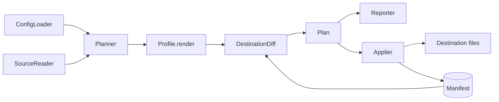

# Architecture

This document describes how a sync flows through SkillSinc's modules and how ownership is tracked. It is for contributors changing the planner, profiles, or apply logic.

## Flow

A run reads each routed source once, renders every selected item through the destination's profile, compares the result with the destination's files and ownership manifest, and only then writes.

## Modules

| Module                        | Responsibility                                                      |
| ----------------------------- | ------------------------------------------------------------------- |
| `config`                      | Parse and validate `config.toml` into frozen dataclasses            |
| `sources`                     | Read a library completely or raise `SourceError`                    |
| `frontmatter`                 | Split Markdown into YAML frontmatter and body; render it back       |
| `profiles/*`                  | Per-harness layout and conversion; return files, blocks, and losses |
| `planner`                     | Select items per route, render, apply loss policy, detect clashes   |
| `diff`                        | Compare desired files and blocks with disk and the manifest         |
| `blocks`                      | Find, replace, and remove the managed block in a Markdown file      |
| `manifest`                    | Load and atomically save per-destination ownership records          |
| `applier`                     | Verify preconditions, write atomically, update the manifest         |
| `lock`                        | Serialize overlapping `sync` runs                                   |
| `report`                      | Text and versioned JSON output                                      |
| `cli`, `commands`, `__main__` | Argument parsing, command handlers, exit codes                      |

## Ownership

Each destination has a manifest at `$XDG_STATE_HOME/skillsinc/manifests/<destination>.json` (default `~/.local/state/skillsinc/`, on every platform). It maps destination-relative paths to the SHA-256 of the content SkillSinc last wrote, plus any managed blocks and whether SkillSinc created their file.

| Disk state                      | In manifest? | Desired? | Planned action                         |
| ------------------------------- | ------------ | -------- | -------------------------------------- |
| Missing                         | any          | yes      | `create`                               |
| Differs from desired            | yes          | yes      | `update` (notes local edits)           |
| Present                         | no           | yes      | blocked; `--adopt` → `adopt`/`track`   |
| Matches recorded digest         | yes          | no       | `delete`, then prune empty directories |
| Edited since SkillSinc wrote it | yes          | no       | `forget` (left in place, released)     |
| Missing                         | yes          | no       | `forget`                               |

## Managed blocks

Harnesses that read a single instructions file (Codex's `AGENTS.md`) receive one block delimited by `<!-- skillsinc:begin -->` and `<!-- skillsinc:end -->`. Content outside the markers is never changed. Damaged markers block the destination rather than guessing.

## Safety checks

- Every change records the digest of the file it expects; the applier re-reads and refuses if the file changed after planning.
- Writes go to a sibling temporary file, then `Path.replace` swaps it in.
- The manifest is saved after every applied change, so an interrupted run never loses track of written files.
- Paths that pass through a symlink or junction inside a destination are refused, so a sync can never write back into the library through a link.

## Adding a harness

1. Add a `Profile` subclass in `src/skillsinc/profiles/` with `name`, `summary`, `support`, `default_path`, and `render`.
2. Register it in `ProfileRegistry`.
3. Report every dropped field through `LossPolicy` or an explicit loss message.
4. Add profile tests and a journey test; document it in [harness profiles](../guides/harness-profiles.md).
